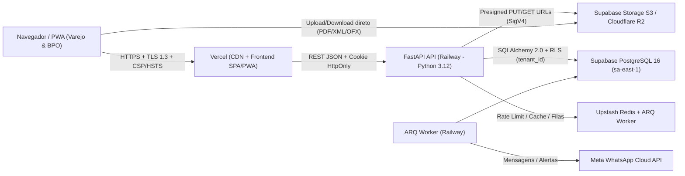
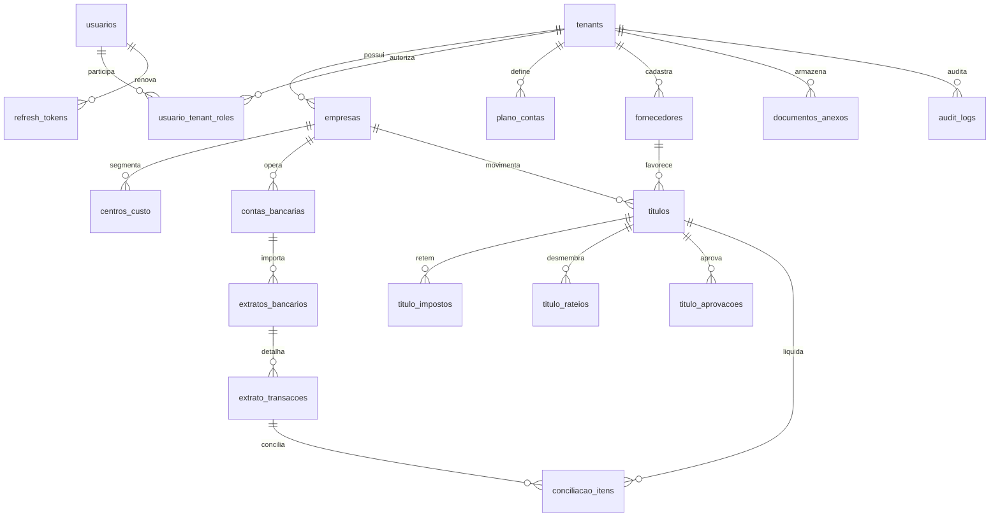

# Arquitetura SaaS Multi-Tenant — JR FinCloud

**Produto:** JR FinCloud (JR Solutions)  
**Posicionamento:** Plataforma Financeira, Contas a Pagar, Rateios e Compliance Fiscal para **Varejo Multi-Loja / Shoppings** e **Escritórios de BPO Financeiro & Contadores**  
**Versão:** 2.0 (Onda 1 — Fundação SaaS)

---

## 1. Visão Geral & Topologia Cloud (Stack Vercel + Railway + Supabase)

### FinOps — Estimativa de Custo Inicial (Primeiros 30 Clientes)

| Camada | Provedor Recomendado | Função | Faixa Mensal Estimada |
| :--- | :--- | :--- | :--- |
| Frontend SPA/PWA | **Vercel** | Hospedagem estática global + CDN + Headers (`vercel.json`) | R\$ 0 (Hobby/Pro) |
| Backend API + Worker | **Railway** | Containers Docker sem hibernação (`Dockerfile` + Alembic) | R\$ 80 – R\$ 180 |
| Banco Relacional | **Supabase** (`sa-east-1`) | PostgreSQL 16 gerenciado + RLS + PITR + Backups | R\$ 125 – R\$ 150 |
| Object Storage | **Supabase Storage S3** / Cloudflare R2 | Armazenamento privado XML/PDF/OFX (URLs pré-assinadas) | R\$ 0 – R\$ 30 |
| Cache & Filas | **Upstash Redis** | Rate limit distribuído + filas assíncronas | R\$ 0 – R\$ 50 |
| Observabilidade | **Sentry + BetterStack** | Telemetria de erros + uptime + logs JSON | R\$ 0 – R\$ 40 |
| **Total Estimado** | | | **R\$ 205 – R\$ 450/mês** |

---

## 2. Modelo de Dados Multi-Tenant (PostgreSQL 16)

### Garantias de Integridade & Precisão
- **Precisão monetária absoluta:** todos os valores financeiros usam `NUMERIC(15, 2)` (e alíquotas `NUMERIC(6, 4)`), processados em Python exclusivamente com `decimal.Decimal` (`ROUND_HALF_UP`).
- **Isolamento Multi-Tenant via Row-Level Security (RLS):**
  - Toda tabela de negócio possui `tenant_id VARCHAR(36) NOT NULL`.
  - A cada requisição autenticada em `/api/v2`, `get_tenant_context()` valida o vínculo do usuário em `usuario_tenant_roles` e aplica `SET LOCAL app.current_tenant_id = :tenant_id`.
  - Políticas `CREATE POLICY tenant_isolation` no PostgreSQL (com `FORCE ROW LEVEL SECURITY`) impedem vazamento entre empresas mesmo em caso de falha na camada de aplicação.
- **Modelo Híbrido Varejo + BPO:**
  - `tenants.is_bpo_partner` e `tenants.parent_bpo_tenant_id` permitem que um escritório de BPO/Contabilidade gerencie dezenas de clientes e alterne de workspace via `POST /api/v2/auth/switch-tenant` sem precisar de múltiplos logins.

---

## 3. Segurança & Fluxo de Autenticação v2

1. **Access Token (JWT HS256, TTL 15 min):** carrega `sub` (`usuario_id`), `tenant_id`, `role` (`OWNER`, `DIRETOR_APROVADOR`, `FINANCEIRO`, `CONTADOR_LEITURA`, `SOLICITANTE`), `jti` e `token_type="access"`.
2. **Refresh Token (Opaco 256-bit, TTL 30 dias):** armazenado apenas como hash SHA-256 na tabela `refresh_tokens` com `family_id` e entregue via cookie `HttpOnly; Secure; SameSite=Lax`.
3. **Rotação & Detecção de Reuso:** a cada `POST /api/v2/auth/refresh`, o token anterior é revogado e substituído. Se um token já revogado for reutilizado (indício de roubo), **toda a família de tokens é revogada imediatamente**, exigindo novo login.
4. **Auditoria Imutável (`audit_logs`):** todas as operações sensíveis gravam usuário, tenant, ação, entidade, valores `antes/depois` em JSON, IP e timestamp UTC.

---

## 4. Object Storage Privado (Cloudflare R2 / S3)

- Bucket **100% privado**; nenhum documento fiscal é exposto por URL pública.
- Fluxo em 3 passos sem trafegar binários pesados pelo backend:
  1. Cliente solicita `POST /api/v2/storage/presign-upload` informando `mime_type`, `tamanho_bytes`, `sha256` e vínculo (`entidade_tipo`, `entidade_id`).
  2. API valida `tenant_id`, MIME permitidos (`application/pdf`, `application/xml`, `text/xml`, `application/x-ofx`, `text/plain`, `image/png`, `image/jpeg`), limite de 15 MB e gera **Presigned PUT URL** (AWS SigV4, expiração 5 min) apontando para `tenants/{tenant_id}/{empresa_id}/{ano}/{mes}/{entidade}/{uuid}.{ext}`.
  3. Leitura ocorre via `GET /api/v2/storage/{anexo_id}/presign-download` (valida posse do `tenant_id` e emite Presigned GET URL com validade de 5 min).

---

## 5. Comparativo Prático: Supabase vs Render vs Vercel vs Railway

Para o JR FinCloud, **essas plataformas não competem todas entre si** — cada uma cumpre uma camada diferente:

| Plataforma | Camada | Papel Recomendado | Observação Prática |
| :--- | :--- | :--- | :--- |
| **Vercel** | **Frontend (SPA/PWA)** | **Sim — Camada Web** | Excelente para HTML/React estático + CDN global + headers de segurança via `vercel.json`. Não usar para rodar API FastAPI nem banco. |
| **Railway** | **Backend API + Worker** | **Sim — Camada API** | Roda o `backend/Dockerfile` continuamente sem *cold start* (ao contrário do Render Free), escala workers Python/ARQ e tem deploy integrado com GitHub. |
| **Render** | Backend alternativo | Substituto do Railway | Plano gratuito hiberna após 15 min (30–60s para acordar, ruim para ERP); plano pago empata em custo com Railway/Fly.io sem vantagens extras aqui. |
| **Supabase** | **Banco PostgreSQL 16 + RLS + Storage S3** | **Sim — Camada de Dados** | PostgreSQL gerenciado na região **São Paulo (`sa-east-1`)**, suporte nativo às políticas **Row-Level Security (RLS)** da migration `0002`, backups/PITR e Storage S3-compatible para XML/PDF/OFX (com opção de migrar arquivos pesados para **Cloudflare R2** caso o volume de downloads cresça). |

### Fluxo Recomendado de Deploy (Vercel + Railway + Supabase)
1. **Supabase (`sa-east-1` São Paulo):** criar o projeto, copiar a *Connection String* (Session Pooler IPv4, porta `5432`, `?sslmode=require`), criar um bucket privado `jr-fincloud-docs` e gerar as chaves S3 em *Project Settings → Storage*.
2. **Railway:** conectar o repositório configurando `Root Directory = backend` (ou `railway.json`), preencher as variáveis de ambiente (`ENV=production`, `JWT_SECRET_KEY`, `DATABASE_URL`, `CORS_ORIGINS=https://seu-app.vercel.app`, credenciais S3/R2). O comando de start já executa `alembic upgrade head` antes do `uvicorn`.
3. **Vercel:** importar o repositório configurando `Output Directory = frontend` (já mapeado em `vercel.json`) e apontar a URL da API para o domínio HTTPS gerado pelo Railway.

---

## 6. Checklist de Go-Live & Segurança

1. **Histórico Git Limpo (`finance_compilance`):** manter o repositório zerado sem bancos `.db` nem arquivos `.env`; qualquer credencial exposta anteriormente (`TURSO_AUTH_TOKEN`, `JWT_SECRET_KEY`, senhas antigas) deve ser rotacionada.
2. **Provisionar infraestrutura alvo (Supabase + Railway + Vercel):**
   - Criar projeto PostgreSQL 16 no **Supabase** (`sa-east-1`) e bucket privado `jr-fincloud-docs` (Storage S3);
   - Conectar o repositório no **Railway** (usa `railway.json` + `Dockerfile` da raiz, executando `alembic upgrade head` automaticamente no start);
   - Conectar o repositório na **Vercel** (`vercel.json` já aponta `outputDirectory = frontend` com headers de segurança);
   - Opcionalmente executar o ETL de migração de dados legados: `python scripts/migrar_sqlite_para_postgres_saas.py`.
